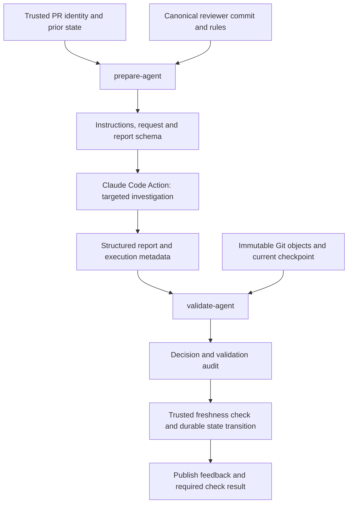

# Agent Review Integration Specification

Status: draft for review. This specifies an agent-compatible path; it does not approve a policy change, deploy a gate, or implement an executable interface. Claude review remains mandatory. Sentinel's production review is unchanged.

## 1. Goal and non-goals

`sentinel-review-system` owns the canonical review rules, investigation procedure, report contract, and deterministic decision logic. Sentinel's `claude-code-review.yml` is the integration workflow. Claude Code Action provides execution and investigation tools, not a competing checklist or a second independent review.

Use one agent investigation per authorized run, with cumulative PR context and targeted source retrieval. Do not call the existing partition runner underneath the agent. Do not introduce a graph database, another model caller, automatic repair calls, automatic spend increases, code editing, application test execution, or a software-factory expansion in this interface.

This proposal addresses repeated context delivery. It does not establish review accuracy, exhaustive runtime impact coverage, a particular latency, or a dollar cost. A mandatory review can still be incomplete when its required investigation cannot be completed within approved limits.

See [the capability check](claude-action-capability-check.md) for the inspected action source, supported outputs, and unverified execution controls.

## 2. Two review entry points

The contract below originally proposed `prepare-agent` and `validate-agent`; they now exist as offline-only commands, described in "Current implementation" at the end. The [action-backed adapter](actions-integration.md) has separate activation prerequisites. Existing `prepare`, `prepare-bundle`, `review`, and `record` behavior remains unchanged.

### prepare-agent

Inputs:

- Local source checkout containing exact base and head commit objects; repository owner/name and PR number from trusted orchestration, not PR prose.
- Target base SHA, head SHA, unique run ID including workflow attempt, and the exact review-system commit selected by trusted orchestration.
- Trusted review-system files, plus a validated prior-state checkpoint containing the existing `ReviewLedger` and an opaque state version that changes after every recorded attempt, including incomplete same-head attempts.
- A brand-new output directory. Existing output must not be overwritten or automatically resumed.

Responsibilities:

1. Validate the repository allowlist, run identity, trusted assets, prior-state identity, safe paths, and availability of commit objects. Compute the merge base locally. Do not trust caller-supplied changed paths or changed-line counts.
2. Derive the entire cumulative change set and diff from merge base to head. The previous-head delta is optional navigation context only, including after rebases. Preserve deterministic diff handling and existing changed-line/diff-byte rules.
3. Build direct dependency/caller navigation metadata for changed paths using the existing supported-source/import rules. Keep unresolved or unsupported required context explicit. Do not silently drop neighbors merely because their files were not preloaded into a packet.
4. Assemble canonical agent instructions, the current policy rules, exact identity, prior findings, cumulative diff, change inventory, impact navigation metadata, and the report JSON Schema. Do not automatically serialize every transitive dependency's source.
5. Write `request.json`, `instructions.md`, and `report.schema.json`. Instructions and schema are trusted orchestration inputs; a model response cannot replace them. Return nonzero when required preparation is incomplete; do not invoke a generic-review fallback.

`request.json` is a new `kind: "agent-review"`, `schemaVersion: 1` artifact, not a `ReviewSnapshot` disguised with empty source arrays. Its required content is:

| Field | Meaning |
| --- | --- |
| `identity` | Existing `ReviewIdentity`: repository, PR, target base, head, merge base, policy digest, configured model, run ID |
| `reviewSystemSha` | Exact canonical reviewer commit, not a moving branch name |
| `previousHeadSha` | Prior ledger's last complete reviewed head, including a complete changes_required result; null only when the validated ledger has no complete reviewed head |
| `priorStateVersion` | Trusted checkpoint version; ledger content/head alone cannot distinguish all intervening attempts |
| `priorLedger` | Existing finding ledger, including unresolved blockers |
| `changes`, `size`, `cumulativeDiff`, `deltaDiff` | Existing meanings, independently derived from Git |
| `dependencyEdges` | Direct impact navigation obligations derived independently of the model report |
| `complete`, `limitations` | Preparation status; known gaps cannot be silently converted to complete |

No partition manifest, partition scope, or source-filled per-part requests are generated. The agent's policy digest must cover its trusted policy, instructions, report schema, and validation implementation using an explicit file list and deterministic hashing. Keep packet-mode digest behavior stable; an agent report must not be accepted under a packet-only digest by accident. The exact file list is authored with the implementation and reviewed as a trust input.

### validate-agent

Inputs:

- The trusted prepared request and matching trusted reviewer files.
- A file containing this action invocation's `structured_output`; transport it via environment variables/files, never interpolated shell code.
- Trusted action-execution metadata: conclusion, termination/error status, observed model identity, and originating workflow run/attempt. A model-echoed identity is not evidence of execution.
- The source checkout at the captured commit objects, and a current orchestration checkpoint containing the live PR identity and latest prior-state version.
- A new output directory for validation artifacts. This command does not publish to GitHub or mutate operational state.

Responsibilities:

1. Reject failed, missing, interrupted, timed-out, budget-exhausted, turn-exhausted, mismatched-model, or otherwise unusable execution. A structured result alone cannot override action failure. Missing execution evidence cannot authorize operational success.
2. Revalidate the prepared identity and trusted digest. Reject a result for a different repository, PR, base, head, merge base, policy, model, or run. Treat a changed live head/base or prior-state version as superseded/incomplete, not a current pass. A newer attempt supersedes an older pass even if the ledger bytes are unchanged.
3. Parse strict JSON and the report schema, reject unexpected fields, and apply the preserved coverage/finding/reconciliation rules. The reviewer does not return an independently authoritative verdict.
4. Resolve every claimed source path and citation from immutable Git objects using the revision rules below. Never accept model-supplied source bytes as verification. Retain the verified evidence ranges and source object identifiers as audit data; existence does not prove the model read or understood them.
5. Return `decision.json` containing the existing `GateDecision` shape and a separate validation audit. Exit codes follow existing record conventions: 0 pass, 2 changes_required, 3 incomplete/superseded, 1 operational/input failure. Invalid input must never be exit 0.

A validated `GateDecision` is not, by itself, durable publication or merge authorization. The trusted workflow must recheck freshness and commit the result against the unchanged state version before publishing a successful check. Operational failures retain prior blockers and cannot reuse a historical clean result. Offline fabricated reports can exercise validation but cannot be published or recorded as real reviews.

## 3. Report compatibility and one decision policy

Keep the existing `ReviewReport` fields and meaning: `schemaVersion`, `identity`, `complete`, `limitations`, `coverage`, `findings`, and `reconciliations`. `partitionScope` is forbidden in this agent path. Generate a strict JSON Schema matching those types and the validator, including nested additional-property rejection. Schema acceptance is only structural validation.

Preserve these invariants from [contracts](../src/contracts.ts), [the gate](../src/gate.ts), and [the review procedure](../policy/review.prompt.md):

- Every changed path has exactly one entry per dimension: test-validity, reliability-impact, and maintainability. Missing/duplicate/blocked coverage or nonempty limitations prevents pass.
- Reliability-impact coverage must acknowledge the direct dependency/caller obligations. Derive these independently, not from paths the model elects to mention. Unchanged code may be read for impact; blockers must remain attributed to a changed path.
- Findings retain their rule IDs, severities, concrete impact, introducedBy attribution, exact evidence, and counterevidence. Unknown rules are invalid; a novel concern cannot become a blocker.
- Every prior open finding must be reconciled. Comments, thread dismissal, author disagreement, or omission cannot clear it. No automatic waivers, severity downgrades, or dropped blockers.
- Exact evidence ranges and quotes are required. Do not silently repair, relocate, or normalize an invalid citation. An invalid report cannot trigger an automatically authorized paid repair.
- No compulsory criticism, finding-count quota, or model-selected CLEAN marker. Valid complete reports with no blockers can pass; complete reports with blockers require changes; uncertainty about required coverage remains incomplete.

Do not create a second copy of finding/reconciliation decision logic. Refactor shared validation behind an internal source-lookup seam while preserving packet-mode behavior and regression tests. Agent and packet preparation remain distinct; do not fabricate a dependency-closed snapshot or redefine its completeness to make the old gate accept an agent report.

The current direct-neighbor obligation can still be broad for hub files. Removing that obligation or replacing it with a relevance-ranked subset is a separate policy proposal, not an optimization silently included here.

## 4. Source revisions and access

For existing `Evidence.revision` values, `head` means `identity.headSha` and `base` means `identity.mergeBaseSha`. This preserves current snapshot behavior. `identity.baseSha` is the captured target branch head and is not interchangeable with merge base. Target-branch guidance may be loaded separately as trusted integration context, but must not be mislabeled as merge-base evidence.

- For added paths, inspect head source. For deleted paths, inspect merge-base source. For renamed paths, use `previousPath` at merge base and the new path at head. Review changed before/after behavior, not only added lines.
- Validate paths and object types before source access. Preserve refusal of traversal, secret-like paths, symlinks, submodules, binary/unavailable required source, and required source that cannot be examined safely. Never follow a symlink outside the repository or execute repository code to resolve an import.
- Evidence uses one-based inclusive line ranges and exact source text, with existing line-splitting semantics. Numbering added for presentation is not part of the quote. An out-of-range or wrong-revision citation is invalid.
- The model may investigate with approved file/search/reference tools, but working-tree reads are trustworthy only for an explicitly prepared immutable source view. Claude Code Action restores some configuration paths from the target base branch; that restored view is not identical to PR head for those paths. Changed guidance must be inspected through exact Git objects or a separately prepared source view.
- Source availability and coverage rationale are attestations, not proof of exhaustive impact analysis or actual tool use. Tool restriction, credential isolation, configuration loading, and protection of trusted artifacts must be verified before a credentialed run. A read-only sentence in a prompt is insufficient.

This specification does not choose a custom MCP server or graph store. Choose the smallest verified source-access mechanism during implementation; any mechanism must obey these revision/path constraints. Missing required context or retrieval limits yields incomplete, not truncation disguised as complete.

## 5. Policy limits and state compatibility

Retain current repository allowlist, model identity, blocking rules, cumulative changed-line block threshold, and diff-byte limit. No numeric values change in this specification. Do not automatically add the review-system repository to the reviewed-repository allowlist just because the tooling moved into it.

The current `maxFiles`, `maxSourceBytes`, and `maxPartSourceBytes` measure captured packet content. Their meaning does not automatically transfer to tool-assisted investigation. An approved mapping to agent retrieval limits is required before executable agent preparation can authorize a run; do not reuse those names with silently different semantics, disable them, or claim the context limit disappeared.

Keep [existing ordered-state and replay protections](../src/state.ts). Its `RunRecord` currently embeds `ReviewSnapshot`; the agent artifact is not compatible with that record schema. This draft does not change the journal format or write agent runs into the old journal. A versioned record integration and an authorized durable checkpoint source must be decided before workflow integration. Missing prior history is an error, not an empty ledger.

Local offline fixtures may supply an explicitly fresh or prior checkpoint to test the interface. They are synthetic and cannot establish hosted state authenticity. The workflow must serialize or compare-and-swap final state transitions; cancellation alone does not prevent stale same-head results.

## 6. Integration sequence



Static review does not execute Sentinel tests. Existing CI and human approval remain independent merge requirements. Feedback must be derived from the validated report, not consumed as authority from PR comments.

Test PRs target Sentinel's `staging` and use `POC Test: <short description>-DO NOT REVIEW`. The marker is for humans and must not disable the intended Claude test review. The workflow loads an explicitly selected review-system commit originating from its integration branch. Do not run the old experimental packet reviewer alongside it. No production workflow is changed by this draft.

## 7. Approval points and implementation order

The user has approved the architecture direction, mandatory review, canonical repository ownership, and staging experiments. The following are proposals or unresolved prerequisites, not new approvals:

| Item | Required decision |
| --- | --- |
| A1: Agent protocol | Approve targeted source delivery and the two-entry-point contract in place of mandatory partitioned packets for this path; preserve canonical blocking and reconciliation semantics |
| A2: Retrieval and execution limits | Define source-retrieval limits and numeric turn/time/spend controls; agree on how model/price usage is verified; no paid run until explicitly authorized |
| A3: Prior state and publication | Select the authorized durable state/checkpoint source and versioned record integration; preserve incomplete-run and replay protections |
| A4: Credentials and tools | Verify private-repository checkout authorization, OIDC branch eligibility, trusted settings, restricted tools, and no model-side publishing |

After A1, implement preparation and pure validation offline with synthetic execution metadata. Extract shared gate logic without semantic changes and run packet-mode regressions. Cover changed revisions, renamed/deleted source, invalid citations/JSON/schema, missing dimensions, omitted direct callers, unacknowledged blockers, and stale/interrupted executions against these preserved requirements. A2-A4 remain blockers to credentialed workflow integration, not reasons to weaken required review.

No automatic retries, monetary increases, publishing, branch creation, or policy changes are authorized by this document. Passing deterministic checks does not establish model quality. Before requesting a paid POC, present the actual workflow diff, selected reviewer commit, execution limits, and remaining known limitations.

## Current implementation (offline only)

`prepare-agent` and `validate-agent` are implemented as offline-only CLI seams for local
contract verification. They are not operational approvals: no model executes, no journal or
operational state is read or written, and every emitted artifact is labeled
`synthetic: true, operational: false`.

```
cli prepare-agent --offline true --checkout PATH --repository OWNER/REPO --pr N \
  --base REF --head REF --run-id ID --review-system-sha SHA \
  --prior-state FILE --validation-limits FILE --out DIR [--system-root PATH]

cli validate-agent --offline true --checkout PATH --request FILE --report FILE \
  --execution FILE --current FILE --prior-state FILE --out DIR [--system-root PATH]
```

`--offline` must be the literal value `true`; `--execute`, `--live`, `--state-root`, and any
other live-mode or state flags are refused. `--review-system-sha` is a validated 40-hex
identity label only; it does not authenticate a release. The prior-state file is the
synthetic checkpoint shape `{schemaVersion: 1, repository, pullRequest, stateVersion,
ledger}`; a missing or invalid checkpoint is an input error, never an implicit empty
ledger. The validation-limits file is `{maxFiles, maxSourceBytes, maxReadBytes}`, all
required positive integers, and it bounds only offline local source reads during
verification; it is not an approved retrieval, model, or spend policy.

`prepare-agent` writes `request.json` (`kind: "agent-review"`), `instructions.md`, and
`report.schema.json` into a brand-new private output directory and exits 0 when preparation
is complete, 3 with explicit limitations, 1 on malformed input. A required source that is
missing, unreadable, or unsafe (canonical policy context at merge base, changed head/base
source, symlinked, binary, non-UTF-8, oversized for the read profile) makes preparation
incomplete, never silently prepared.

`validate-agent` writes `decision.json` (`kind: "offline-agent-decision"`),
`validation-audit.json`, and a preserved copy of the report bytes, exiting 0 synthetic
pass, 2 synthetic changes_required, 3 incomplete, 1 malformed invocation/input. A synthetic
pass demonstrates contract mechanics only and authorizes nothing.

The shared single-review gate accepts a narrowed `ReviewEvaluationContext` whose `files`
are a locally verified evidence cache built from immutable Git objects, not a packet served
to a model and not an arbitrary dependency closure. The validation limits bound only
offline local source reads during verification (unique cached sources, cumulative bytes,
per-read bytes); they do not bound repository-wide index/graph memory, model turns, or
spend. No live tool restriction, permission, credential, or authentication validation is
implemented; execution and current attestations are synthetic host claims, not proof of a
real run.
