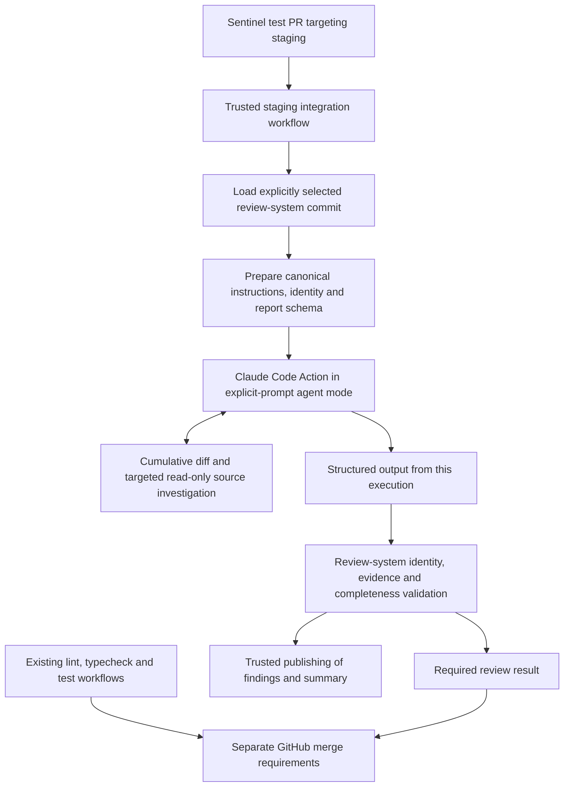

# Claude Code Action Capability Check

## Scope and status

This is a source-based capability check and integration proposal, not an approved implementation or a successful runtime test. Claude review remains mandatory. Sentinel's production workflow and rulesets are unchanged. No upstream code, paid model call, or Sentinel test was executed for this check.

The inspected action tag `v1.0.248` resolved to commit `1d6de8cb0c237e7c15e9e1bdf973826ebae490cc`. This identifies the source inspected now, not proof of what an earlier run downloaded. The entrypoint specifies Claude Code `2.1.296` unless a custom executable is supplied [S1]. Live CLI documentation is supplementary evidence, not a substitute for checking the deployed executable.

Read-only source captures and provenance are retained locally under `.artifacts/action-capability-check/` (ignored). See `PROVENANCE.md` there for UTC capture times and file inventory. Repository documents and implementation references below describe the currently inspected staging baseline; they can drift after implementation changes.

## Findings

### 1. Our system can supply the review task

An explicit `prompt` selects agent mode for supported PR events unless `track_progress` forces tag mode [S2]. Agent mode writes the supplied prompt directly to the prompt file, without the tag-mode review template [S3]. The action is therefore a viable execution harness for our canonical review procedure, rather than a second independent reviewer.

This does not remove Claude Code's general runtime system prompt. The SDK adapter defaults to the `claude_code` preset [S4]. Canonical Sentinel review rules must be supplied explicitly, and legacy review checklists must not remain a competing authority. Instructions alone are not an enforcement mechanism or a prompt-injection defense.

### 2. Structured output is an existing integration seam

The action exposes `structured_output`, `execution_file`, and `conclusion` outputs [S5]. With `--json-schema`, the SDK runner requires successful structured output; missing output or an errored execution fails [S6]. This avoids deriving the gate verdict from arbitrary PR comments.

A JSON Schema validates shape, not current-commit provenance, source evidence, review completeness, or semantic accuracy. Trusted orchestration must establish those separately. Our current TypeScript report contract is not itself a JSON Schema [L1]. The action's schema restrictions, missing-output handling, and large-result transport still need offline integration checks.

### 3. Tool controls require more than allowedTools

The action parses and passes allowed/disallowed tool rules and supports settings [S4, S5]. Current official CLI docs distinguish `--allowedTools` (permission auto-approval) from `--tools` (built-in tool availability); MCP tools need separate controls [D1]. The pinned adapter passes remaining arguments through to the CLI [S4].

Agent mode conditionally configures GitHub MCP servers when corresponding tools are requested [S7]. Do not grant inline-comment, write, or broad API tools to the reviewer merely because the existing workflow does. Proposed publishing belongs to trusted post-validation orchestration, not the model.

An explicit tool set and permission rules need offline negative checks. Bash, if included, is not made read-only by a prompt. Repository and AWS permissions must be least privilege independently of tool controls. No sandbox or read-only execution guarantee was established in this check.

### 4. Execution limits exist, with important qualifications

The adapter maps `--max-turns` into SDK options, and its runner rejects a successful result that exceeds that configured turn count [S4, S6]. Other CLI arguments are passed through [S4]. Current CLI documentation describes `--max-budget-usd` as an estimated session-cost control that can overshoot and differ from billed cost [D1]. It is not the existing runner's reservation accounting and not an AWS-account spending ceiling.

A workflow timeout is a separate elapsed-time control. No turn, spend, or time values are selected here. Bedrock-specific model pricing/accounting and budget termination behavior remain unverified by execution. Cancellation and retries can incur charges and must not automatically authorize another run.

### 5. Bedrock credentials can remain in Sentinel's workflow

The action supports `use_bedrock` and forwards the AWS region and temporary credential environment variables [S5, S8]. Obtaining credentials through the authorized GitHub OIDC role remains a workflow responsibility. Checking out a second repository does not change the calling job's OIDC identity.

This check did not test AWS role trust, branch eligibility, current credentials, model access, or cross-repository checkout access. The review-system repository is private, so the integration must explicitly provide authorized read access rather than assume Sentinel's default GITHUB_TOKEN can read it [D2].

### 6. Repository configuration is another trust input

Before running Claude on PRs, the action restores a fixed list of sensitive configuration paths from the target base branch, including `.claude/`, `.mcp.json`, `CLAUDE.md`, and `.husky/` [S1, S9]. Other PR-controlled files remain. Base-branch hooks that invoke PR-controlled package scripts can still execute untrusted code, as the action's own security documentation warns [S10].

The adapter defaults to user, project, and local settings sources; its settings setup enables project MCP servers [S4, S11]. We must explicitly choose trusted settings/MCP configuration and verify automatic guidance behavior. Adding a system-prompt file or disabling a settings source must not be assumed to neutralize every instruction or executable configuration source. Do not run Sentinel installs, hooks, scripts, or tests inside the credentialed static-review step.

### 7. The current review-system is not a drop-in agent adapter

The existing review prompt refers to a captured packet, and the runner/partition prompts require supplied, partition-scoped sources [L2]. The runner reconstructs source-filled requests and the gate checks evidence against captured snapshot files [L3, L4]. Switching the model caller alone would retain incompatible assumptions or the whole-file context expansion.

Preserve canonical rules, exact identity checks, evidence checks, cumulative review, and prior-finding reconciliation. Introduce an agent-compatible preparation and validation path that obtains evidence from immutable base/head Git objects without requiring transitive whole-file closure. Do not pass an agent report directly into the existing packet validator and claim equivalent coverage. Graph reachability and model coverage entries are not proofs of semantic correctness.

## Proposed integration flow

This is a design proposal, not deployment approval. A missing, stale, invalid, blocked, or incomplete review must not yield a passing result. Exact blocking policy and exception authority are not changed here. Human-facing comments are not the gate authority.

For the POC, test PR titles must be `POC Test: <short description>-DO NOT REVIEW`. That marker is for humans and must not suppress the intended test reviewer. Prevent duplicate execution by the old experimental `sentinel-review.yml` path when wiring the replacement staging path. Sentinel's production mandatory review remains unchanged.

## Next implementation decisions and evidence required

1. Author and review the agent-compatible instruction/report interface. Do not edit the existing packet contract implicitly or duplicate its blocking policy in YAML. Preserve the three review dimensions and existing finding/reconciliation semantics unless explicitly approved otherwise.
2. Define immutable run identity and source-evidence lookup, including deleted/renamed files and head changes during a run. A source read from a moving PR endpoint is not automatically evidence for the captured head.
3. Select and negatively test tool permissions, configuration loading, and suppression of model-side publishing. Verify prompt-file flags through the pinned SDK/CLI path before relying on them; this source check establishes pass-through, not their precedence against SDK prompt options.
4. Verify schema serialization, structured-output extraction, missing/error/budget/turn termination, and shell-safe handoff to the validator. Transport untrusted JSON through files or environment variables, not shell interpolation.
5. Specify prior-finding persistence and recovery. The existing staging workflow uses temporary runner state [L5]; it does not supply durable cross-run reconciliation just by uploading artifacts.
6. Obtain authorized private-repository read access and verify OIDC branch eligibility. Agree on spend/time/turn limits before any paid test. Do not add credentials to documentation.
7. Run offline contract checks first, then request authorization for a single budget-bounded POC review. Passing schema or deterministic tests is not evidence of model review quality.

## Sources

Pinned sources below all use commit `1d6de8cb0c237e7c15e9e1bdf973826ebae490cc`:

- [S1] [Action entrypoint and CLI installation](https://github.com/anthropics/claude-code-action/blob/1d6de8cb0c237e7c15e9e1bdf973826ebae490cc/src/entrypoints/run.ts)
- [S2] [Mode detection](https://github.com/anthropics/claude-code-action/blob/1d6de8cb0c237e7c15e9e1bdf973826ebae490cc/src/modes/detector.ts)
- [S3] [Explicit-prompt agent mode](https://github.com/anthropics/claude-code-action/blob/1d6de8cb0c237e7c15e9e1bdf973826ebae490cc/src/modes/agent/index.ts)
- [S4] [SDK option parsing](https://github.com/anthropics/claude-code-action/blob/1d6de8cb0c237e7c15e9e1bdf973826ebae490cc/base-action/src/parse-sdk-options.ts)
- [S5] [Action inputs and outputs](https://github.com/anthropics/claude-code-action/blob/1d6de8cb0c237e7c15e9e1bdf973826ebae490cc/action.yml)
- [S6] [SDK execution and structured-result handling](https://github.com/anthropics/claude-code-action/blob/1d6de8cb0c237e7c15e9e1bdf973826ebae490cc/base-action/src/run-claude-sdk.ts)
- [S7] [GitHub MCP configuration](https://github.com/anthropics/claude-code-action/blob/1d6de8cb0c237e7c15e9e1bdf973826ebae490cc/src/mcp/install-mcp-server.ts)
- [S8] [Cloud-provider configuration](https://github.com/anthropics/claude-code-action/blob/1d6de8cb0c237e7c15e9e1bdf973826ebae490cc/docs/cloud-providers.md)
- [S9] [Sensitive configuration restoration](https://github.com/anthropics/claude-code-action/blob/1d6de8cb0c237e7c15e9e1bdf973826ebae490cc/src/github/operations/restore-config.ts)
- [S10] [Action security guidance](https://github.com/anthropics/claude-code-action/blob/1d6de8cb0c237e7c15e9e1bdf973826ebae490cc/docs/security.md)
- [S11] [Settings setup](https://github.com/anthropics/claude-code-action/blob/1d6de8cb0c237e7c15e9e1bdf973826ebae490cc/base-action/src/setup-claude-code-settings.ts)
- [D1] [Live CLI reference](https://code.claude.com/docs/en/cli-reference)
- [D2] [GitHub checkout: multiple private repositories](https://github.com/actions/checkout#checkout-multiple-repos-private)
- [L1] [Existing TypeScript contracts](../src/contracts.ts)
- [L2] [Cumulative review prompt](../policy/review.prompt.md), [partition protocol](../policy/partition.prompt.md), and [runner presentation](../policy/runner.prompt.md)
- [L3] [Existing partition runner](../src/reviewRunner.ts)
- [L4] [Existing deterministic gate](../src/gate.ts)
- [L5] Sentinel staging workflow inspected at `/private/tmp/sentinel-staging/.github/workflows/sentinel-review.yml`, local branch `staging` at `4dab5e3`; not a live remote-state assertion.
